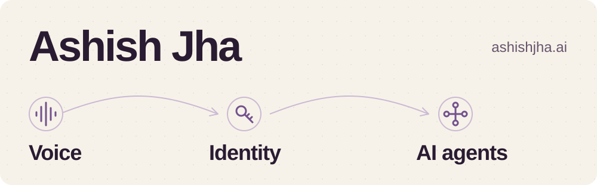

<picture>
  <source media="(prefers-color-scheme: dark)" srcset="assets/header-dark.svg">
  <source media="(prefers-color-scheme: light)" srcset="assets/header-light.svg">
  
</picture>

**Solutions Engineer / Forward Deployed Engineer at [DevRev](https://devrev.ai).**

I build AI agents for customer-facing and internal workflows, connect them to enterprise systems, and work on what they’re allowed to access.

Previously at Okta, working on identity and authorization. Before that, I founded TheDreamSaver, a conversational AI consultancy, and built 1,000+ voice applications across ten Amazon marketplaces. I also contributed to Rocket.Chat through Google Summer of Code in 2019.

### Selected work

| Project | What’s here |
| --- | --- |
| [SmartSpend](https://github.com/TheDreamSaver/fga-spend-guard) | An expense agent with server-side OpenFGA checks and approval rules. [Try the standalone browser demo](https://smartspend-thedreamsaver.vercel.app/). |
| [FGA Docs Visualizer](https://github.com/TheDreamSaver/fga-docs-visualizer) | A local RAG demo that filters document excerpts with OpenFGA before they reach the model. |
| [Auth0 + DynamoDB](https://github.com/TheDreamSaver/auth0-dynamoDB-connection-scripts) | Custom database connection scripts for using an existing DynamoDB user store with Auth0. |
| [Alexa + Rocket.Chat](https://github.com/TheDreamSaver/alexa-rocketchat) | My GSoC contribution to Rocket.Chat’s Alexa integration. This is a fork of the shared project, from 2019. |
| [Alexa Skill Builder training](https://github.com/TheDreamSaver/alexa-oreilly) | Code and exercises from the O’Reilly live training sessions I taught. |
| [Awesome Alexa](https://github.com/TheDreamSaver/awesome-alexa) | A collection of tools, libraries and learning resources from my years building for Alexa. |

### Writing and talks

[Least privilege is not injection prevention](https://ashishjha.ai/writing/least-privilege-is-not-injection-prevention) — what authorization can limit, and what it can’t guarantee about an AI agent’s output.

[More writing](https://ashishjha.ai/writing) · [Conference talks and recordings](https://ashishjha.ai/talks) · [My story](https://ashishjha.ai/about)

Away from code: airplanes, travel, and stopping to say hello to dogs. The rest is on [ashishjha.ai](https://ashishjha.ai).
